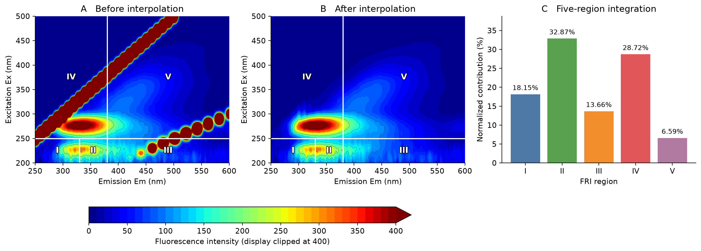

# 三维荧光 EEM：瑞利散射插值与五区积分

把一个文件夹中的三维荧光数据批量处理成可绘图的矩阵，并生成五区荧光区域积分（FRI）结果。Windows 用户下载工具包、复制到数据文件夹、双击运行即可；支持 XLSX 和 CSV，无需编写代码。

## 工具能做什么

1. **读取 EEM**：识别标准行列式 XLSX/CSV，以及已验证的岛津 RF 系列直接导出 CSV；按实际波长读取不同点数和不等间隔的 Em、Ex 轴。
2. **处理瑞利散射**：定位一阶和二阶瑞利散射窗口，用窗口外的数据沿 Em、Ex 两个方向线性插值，生成新的 EEM 矩阵。
3. **计算五区积分**：在插值后的矩阵上计算各区原始积分 `Phi`、面积归一化积分 `PhiN` 和占比 `P`，集中写入一个 XLSX。



图中横轴为发射波长 Em，纵轴为激发波长 Ex。处理前后使用相同色标；绘图时的轻微平滑只改善等高线显示，**输出矩阵和积分均由未经绘图平滑的数据计算**。[查看示例文件与结果](examples/README.md)。

## 三步运行（Windows 64 位）

1. 打开 [Windows 工具包 v1.2.0](dist/eem-rayleigh-fri-win64-v1.2.0.zip)，在文件页面点击 **Download raw file**，下载并解压。
2. 将 `eem_tool.exe` 和 `启动处理.bat` 一起复制到存放 EEM 数据的文件夹。该文件夹可同时放多个 `.xlsx` 和 `.csv`。
3. 双击 `启动处理.bat`。处理完毕后打开自动生成的 `EEM_处理结果` 文件夹。

程序读取所在文件夹顶层的所有 XLSX/CSV；输入文件保持原样。程序运行无需安装 Python、R 或 Excel；打开结果 XLSX 需要 Excel 或兼容软件。

> **Git LFS 下载提示**：工具包以 Git LFS 存储。请在上面的工具包文件页面单独下载；GitHub 首页的 **Code → Download ZIP** 可能只包含工具包的 LFS 指针。

## 输入格式

| 类型 | 表格排列 | 备注 |
|---|---|---|
| 标准 XLSX | A1 空白；第一行 Ex；第一列 Em；内部为荧光强度 | 优先读取 `Sheet1`，否则读取首个工作表；[下载示例](examples/input/示例数据.xlsx) |
| 标准 CSV | 第一行 Ex；第一列 Em；内部为荧光强度 | 与示例 XLSX 相同的行列方向 |
| 岛津 RF 系列直接导出 CSV | 第一行 Em；第一列 Ex；内部为荧光强度 | 自动识别并转为标准方向；已用真实岛津 CSV 验证 |
| PicoQuant F300 CSV | 第一行 Em；第一列 Ex；波长以米记录 | 依据提供的格式脚本实现，已通过模拟文件测试 |

输入波长轴可以有不同点数、不等间隔，或整体倒序。五区积分需要 Ex 范围跨过 **250 nm**，Em 范围跨过 **330 nm 和 380 nm**。每条轴须按波长单调排列，且每个位置都有数值。当前版本处理 XLSX/CSV；仪器 TXT/DAT 导出尚未接入。

## 输出文件怎么读

运行后会得到：

```text
EEM_处理结果/
├─ 01_插值矩阵/          每个输入对应一个可绘图 XLSX
└─ 02_五区积分汇总.xlsx  所有样本的积分及处理记录
```

`01_插值矩阵` 中的 XLSX 与标准输入方向相同：**第一行 Ex、第一列 Em**，其余为处理后的强度。CSV 的结果文件名会保留 `.csv`，再加 `.xlsx`，便于对应原文件。

汇总工作簿中的 `积分结果` 包含：

| 列 | 含义 |
|---|---|
| `Phi_I`～`Phi_V` | 五个区域各自的原始积分 |
| `PhiN_I`～`PhiN_V` | 按区域面积修正后的积分 |
| `P_I`～`P_V` | 面积修正后各区占总量的比例；五区之和为 1 |
| `PhiN_total` | 五区面积修正积分之和 |

`运行记录` 说明每个文件的处理状态和插值点数；`分区面积` 列出每个样本各区域的面积及倍增系数。某个文件失败时，在 `运行记录` 的“说明”列查看原因。

## 处理和计算方法

**散射插值。** 一阶窗口为 `|Em − Ex| ≤ 12 nm`，二阶窗口为 `|Em − (2Ex + 4)| ≤ 20 nm`。程序沿 Em、Ex 两个方向，利用窗口外数据分别线性插值，再取两方向均值；仅替换窗口内数据。窗口外测量值保持原值。

**五区划分。** 在 Em–Ex 平面上按下表积分；`Em ≤ Ex` 处以及负强度按 0 计入。

| 区域 | Ex | Em |
|---|---|---|
| I | ≤ 250 nm | ≤ 330 nm |
| II | ≤ 250 nm | 330–380 nm |
| III | ≤ 250 nm | ≥ 380 nm |
| IV | ≥ 250 nm | ≤ 380 nm |
| V | ≥ 250 nm | ≥ 380 nm |

对于示例仪器的原始网格，积分使用二维梯形法；对于其他波长网格，按照真实坐标拆分网格、沿分区边界裁剪并积分。每区的面积修正系数为 `MF_i = 五区总面积 / 第 i 区面积`，因此 `PhiN_i = Phi_i × MF_i`，`P_i = PhiN_i / ΣPhiN_i`。**原始积分大小与占比排序可以不同**，因为五区面积不同。[使用说明](使用说明.md)包含更多输入与计算细节。

本工具执行散射窗口插值和 FRI；比较不同仪器或扫描设置的结果时，先使用相同波长范围。空白扣除、内滤效应等实验预处理应在输入前完成。

## 源码

入口为 [`eem_tool.py`](eem_tool.py)，CSV 解析在 [`eem_readers.py`](eem_readers.py)。使用源码需要 Python 3 和 [`requirements.txt`](requirements.txt) 中的依赖；例如在数据文件夹运行 `python /path/to/eem_tool.py`，也可以把数据文件夹路径作为第一个参数传入。示例结果可用 [`scripts/build_example.py`](scripts/build_example.py) 重建。
